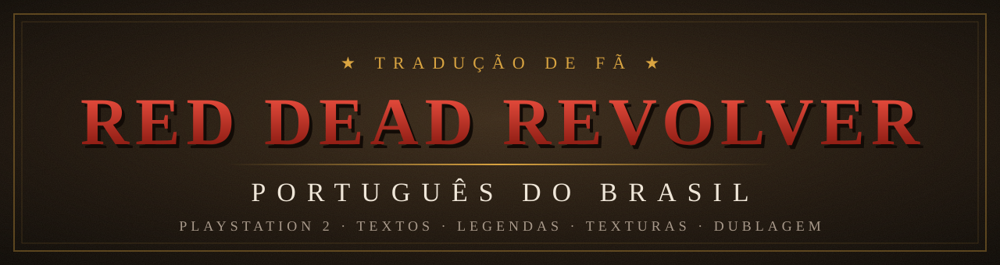
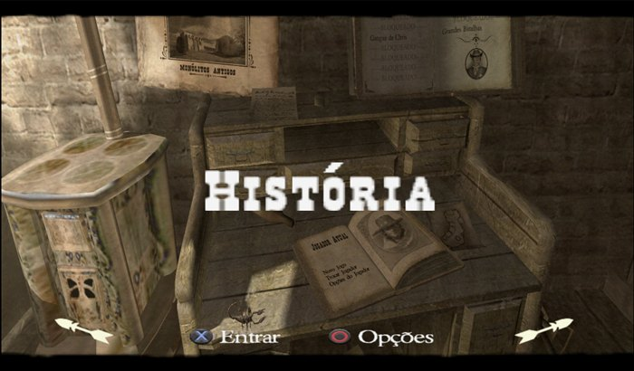
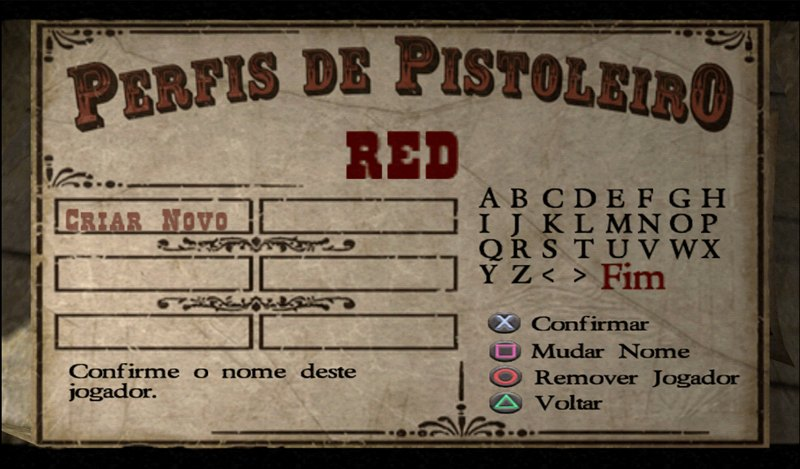
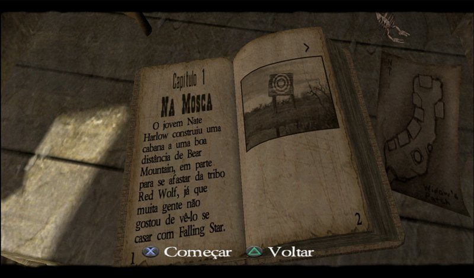
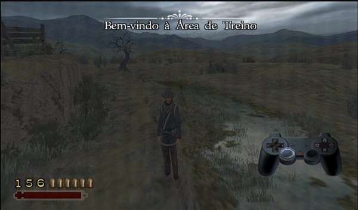
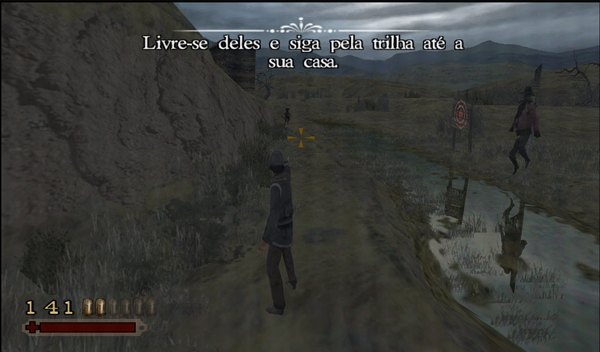
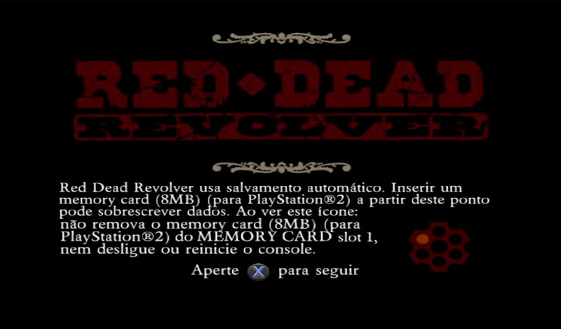

<p align="center">
  
</p>

<p align="center">
  <a href="#-progresso"></a>
  
  
  <a href="CONTRIBUTING.md"></a>
  <a href="LICENSE"></a>
</p>

<p align="center">
  <b>Red Dead Revolver</b> (Rockstar, 2004) inteiro em português do Brasil, feito por fã, para fã.<br>
  Menus, missões, dicas, legendas, texturas redesenhadas e até <b>dublagem</b>, capítulo por capítulo.
</p>

<p align="center">
  <a href="#-como-jogar">Como jogar</a> ·
  <a href="#-progresso">Progresso</a> ·
  <a href="#-como-ajudar">Como ajudar</a> ·
  <a href="docs/TECNICO.md">Documentação técnica</a> ·
  <a href="#-in-english">English</a>
</p>

---

## 🤠 Por que este projeto existe

O faroeste que deu origem à série *Red Dead* nunca saiu em português. Este projeto traduz o jogo de
verdade: não é tradução de máquina colada em cima. É português nativo, com tom de faroeste, revisado
tela por tela no emulador. E quando o texto está desenhado numa imagem, a imagem é refeita em português.

<table>
  <tr>
    <td></td>
    <td></td>
    <td></td>
  </tr>
  <tr>
    <td></td>
    <td></td>
    <td></td>
  </tr>
</table>

## ✨ O que já está em português

- **Interface completa**: menus, opções, perfis, pausa, lojas e telas de recompensa.
- **Todos os textos das missões**: dicas, objetivos, tutoriais e itens (~1.300 frases, ~7.000 palavras).
- **Fontes com acentos**: glifos `á é í ó ú â ê ô ã õ ç` desenhados e adicionados às fontes do jogo.
- **Legendas** das cenas do capítulo 1.
- **Texturas redesenhadas**: cartazes, títulos e o carimbo "CONCLUÍDO" refeitos em português.
- **Diário do Xerife Bartlett**: título, índice, listas e várias imagens das páginas.
- **Dublagem** (experimental): as falas do Nate no capítulo 1 já têm voz em português.

## 📊 Progresso

| Parte | Situação |
|---|---|
| Menus, opções, perfis, pausa | ✅ pronto |
| Textos de missões, dicas e itens | ✅ traduzido · 🔍 revisão em jogo em andamento |
| Avisos (tela legal, salvamento automático, memory card) | ✅ pronto |
| Legendas das cenas | ✅ capítulo 1 · ⏳ capítulos 2 a 22 |
| Texturas com texto | ✅ menu e capítulo 1 · ⏳ demais capítulos |
| Diário: títulos, índice, listas | ✅ pronto |
| Diário: textos das páginas | 🔒 bloqueado: as fontes das páginas não têm acentos ([ajude!](#-como-ajudar)) |
| Dublagem: falas durante o jogo | 🎙️ capítulo 1 em teste |
| Dublagem: cutscenes | 🔬 pesquisa: separar voz da trilha |
| Patch pronto para aplicar (xdelta) | ⏳ em breve |

Capítulo por capítulo: o capítulo 1 (*Na Mosca*) é o primeiro a ser fechado por completo.

## 🎮 Como jogar

> Você precisa da **sua própria cópia** de *Red Dead Revolver* (PS2, EUA, `SLUS-20500`).
> Este repositório **não contém o jogo nem arquivos dele**: as ferramentas leem a sua ISO e geram uma nova, traduzida.

**Patch pronto:** em breve nas [Releases](../../releases). Enquanto isso, dá para gerar a ISO traduzida:

```powershell
# Requisitos: Python 3 (testado no 3.14) e Pillow  (py -m pip install --user pillow)
git clone https://github.com/alanaraujo-bit/red-dead-revolver-ptbr.git
cd red-dead-revolver-ptbr\tools
py -E -X utf8 extract.py   ORIGINAL.iso ..\work\source.json
py -E -X utf8 fontpatch.py ORIGINAL.iso ..\work\fonts_out damaged bosshealth arial14 regulatorcondensed courier18 mapscreen tgs_jp abalinesm
py -E -X utf8 pcktextscan.py ORIGINAL.iso ..\work\pck_static.json
py -E -X utf8 pcktext.py   ORIGINAL.iso
py -E -X utf8 build.py     ORIGINAL.iso ..\work\RDR-PTBR.iso
```

A sua ISO original nunca é alterada. Detalhes, formatos e ferramentas: [docs/TECNICO.md](docs/TECNICO.md).

**PCSX2:** alguns textos do executável ("Criar Novo", "Fim" e os títulos do menu) entram por um patch de cheat:
copie [`traducao/SLUS-20500_E169BAF8.pnach`](traducao/SLUS-20500_E169BAF8.pnach) para a pasta `cheats` do PCSX2 e
ative os cheats nas propriedades do jogo. O CRC não muda, então patches de widescreen e 60 FPS continuam valendo.

## 🙌 Como ajudar

Toda ajuda conta, e não precisa saber programar:

| Você curte... | Pode ajudar com |
|---|---|
| 🎮 **Jogar** | Jogue com a tradução e [abra uma issue](../../issues/new/choose) com print de texto em inglês, erro ou travamento. |
| ✍️ **Escrever** | Revise traduções em [`traducao/`](traducao) seguindo o [glossário](docs/GLOSSARIO.md). |
| 🎨 **Arte** | Refaça texturas com texto em inglês (cartazes, jornais, rótulos) mantendo o estilo original. |
| 🎙️ **Voz** | Dublagem! Use o [estúdio de dublagem](dublagem/) no navegador: ele mostra o texto no tempo certo e grava. |
| 🔧 **Engenharia reversa** | O grande desafio aberto: acrescentar glifos acentuados às fontes das páginas do diário. Os formatos estão em [docs/TECNICO.md](docs/TECNICO.md). |

Leia o [guia de contribuição](CONTRIBUTING.md). Se o projeto te deu nostalgia, **deixe uma ⭐** para mais gente encontrar.

## 🧰 O que tem aqui

```
tools/      ferramentas em Python: ler/remontar DAT, tabelas de texto, fontes, texturas, .pck e áudio
traducao/   a tradução em si (JSON): textos, legendas, interface, executável
dublagem/   estúdio de gravação no navegador + roteiros por capítulo
docs/       documentação técnica, glossário e imagens
```

Destaques da engenharia reversa: o formato de arquivos **DAVE**, as tabelas **strtbl** com hash ELF, as fontes
**fonttex**, os pacotes de interface **.pck** (estilo Flash, com texto compilado e bitmaps em swizzle PSMT8), os
modelos **RSC0** e o áudio **STMA** (IMA ADPCM), que pode ser recodificado bit a bit idêntico ao original.

## ⚖️ Aviso legal

Projeto de fã, sem fins lucrativos, **sem afiliação** com a Rockstar Games ou a Take-Two Interactive.
*Red Dead Revolver* e suas marcas pertencem aos seus donos. Nenhum arquivo do jogo é distribuído aqui.
Código sob [MIT](LICENSE); textos da tradução e roteiros sob [CC BY-SA 4.0](LICENSE-TRADUCAO.md).

## 🌎 In English

A complete **Brazilian Portuguese fan translation** of *Red Dead Revolver* (PS2, NTSC-U `SLUS-20500`): UI, missions,
subtitles, redrawn textures and experimental voice dubbing, done chapter by chapter and tested on PCSX2.
The repo ships only tools and translation data. Bring your own ISO. The reverse-engineering notes
([docs/TECNICO.md](docs/TECNICO.md), in Portuguese) cover the DAVE archives, strtbl string tables, fonttex fonts,
Flash-like `.pck` UI packages, RSC0 texture packs and STMA IMA-ADPCM audio. They may help other Angel Studios /
Rockstar San Diego titles too. Issues and PRs in English are welcome.

---

<p align="center">Feito com 🤠 por <a href="https://github.com/alanaraujo-bit">@alanaraujo-bit</a> e contribuidores, com uma mãozinha de IA (Claude e Gemini).</p>
